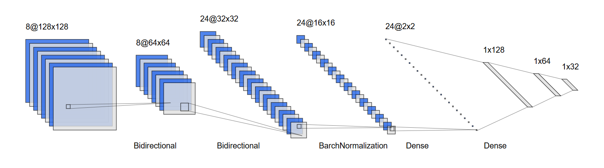
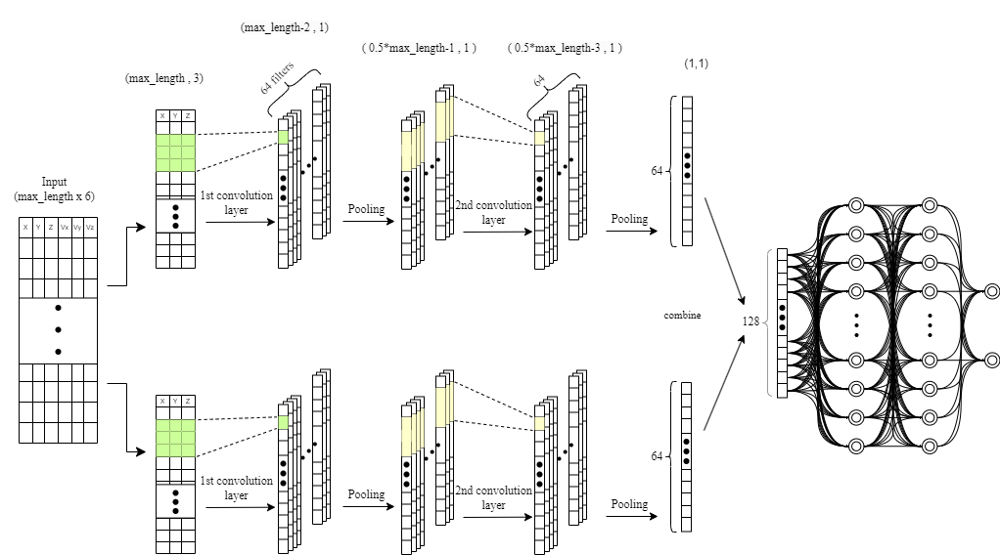

## Validation of a Microfluidic Device Prototype for Cancer Detection and Identification: Circulating Tumor Cells Classification Based on Cell Trajectory Analysis Leveraging Cell-Based Modeling and Machine Learning
<hr>


[](https://www.python.org/)
[](https://numpy.org/)
[](https://pandas.pydata.org/)
[](https://matplotlib.org/)
[](https://seaborn.pydata.org/)
[](https://scikit-learn.org/)
[](https://www.tensorflow.org/)
[](https://drive.google.com/file/d/147op9PkdE6MS007_jOWV5w5K7Ned2aQF/view?usp=sharing)
[](https://github.com/imsanjoykb/Text-Generation/LICENCE.txt)
[](https://doi.org/10.1000/xyz123)
[](https://github.com/imsanjoykb/vMDpcDI-CTC_Modeling/stargazers)

<hr>

## Abstract
>Microfluidic devices (MDs) offer an advanced approach for detecting circulating tumor cells (CTCs), improving detection through targeted methods and visual inspection. Despite these advancements, existing techniques often produce heterogeneous CTC populations, requiring further processing for thorough analysis and phenotype identification. This study investigates the use of a hyperuniform micropost MD for CTC classification. We integrate mathematical modeling of fluid-structure interactions within a simulated microfluidic channel with machine learning techniques to enhance classification accuracy.
<hr>

## Project Installation and Run

<b>Create the virtual environment</b>
```
pip install virtualenv
virtualenv venv 
venv\Scripts\activate  
```
<b>Install Dependencies</b>
```
pip3 install -r requirements.txt
```
<b>Run GRU Code/Notebook</b>
```
python gru_model.py
or,
GRU_Model.ipynb
```
<b>Run CNN Code/Notebook</b>
```
python cnn_model.py
or,
CNN_Model.ipynb
```
```
python main.py
```
<b>Run Final and Merge Model</b>
```
GRU-CNN_Final_Model.ipynb
```
<hr>

## GRU Architecture & Model

```python
# Define the GRU model for classification
model = Sequential([
    Bidirectional(GRU(128, return_sequences=True), input_shape=(max_length, 6)),
    BatchNormalization(),
    Dropout(0.3),
    Bidirectional(GRU(64, return_sequences=True)),
    BatchNormalization(),
    Dropout(0.3),
    Bidirectional(GRU(32)),
    BatchNormalization(),
    Dropout(0.3),
    Dense(16, activation='relu'),
    Dense(2, activation='softmax')
])

# Compile the model with a different learning rate
model.compile(optimizer=tf.keras.optimizers.Adam(learning_rate=0.0005), loss='categorical_crossentropy', metrics=['accuracy'])

# Early stopping and learning rate reduction on plateau
early_stopping = EarlyStopping(monitor='val_loss', patience=10, restore_best_weights=True)
reduce_lr = ReduceLROnPlateau(monitor='val_loss', factor=0.2, patience=5, min_lr=0.00001)
```
## CNN Architecture & Model

```python
# Separate inputs for position and velocity
position_input = Input(shape=input_shape)
velocity_input = Input(shape=input_shape)

# Convolutions for position
x_pos = Conv1D(64, kernel_size=3, activation='relu')(position_input)
x_pos = MaxPooling1D(2)(x_pos)
 x_pos = Conv1D(64, kernel_size=3, activation='relu')(x_pos)
x_pos = GlobalAveragePooling1D()(x_pos)

# Convolutions for velocity
x_vel = Conv1D(64, kernel_size=3, activation='relu')(velocity_input)
x_vel = MaxPooling1D(2)(x_vel)
x_vel = Conv1D(64, kernel_size=3, activation='relu')(x_vel)
x_vel = GlobalAveragePooling1D()(x_vel)

# Combine features
combined = concatenate([x_pos, x_vel])

# Dense layers
x = Dense(128, activation='relu')(combined)
x = Dense(64, activation='relu')(x)
output = Dense(2, activation='softmax')(x)
```
<hr>

## Citing
```
@misc{vMDpcDI: CTC Modeling,
  author = {Rifat Rejuan1, Eugenio Aulisa1, Wei Li3‡, Travis Thompson1, Sanjoy Kumar, Suncica Canic, Yifan Wang1},
  title = {Validation of a Microfluidic Device Prototype for Cancer Detection and Identification: Circulating Tumor Cells Classification Based on Cell Trajectory Analysis Leveraging Cell-Based Modeling and Machine Learning},
  year = {2024},
  publisher = {Will be updated},
  journal = {Will be updated},
  url="Will be updated",
}
```
<hr>

###
[](http://makeapullrequest.com)
[](https://github.com)
[](https://visualstudio.microsoft.com)
[](https://github.com/Naereen/badges)

<hr>


